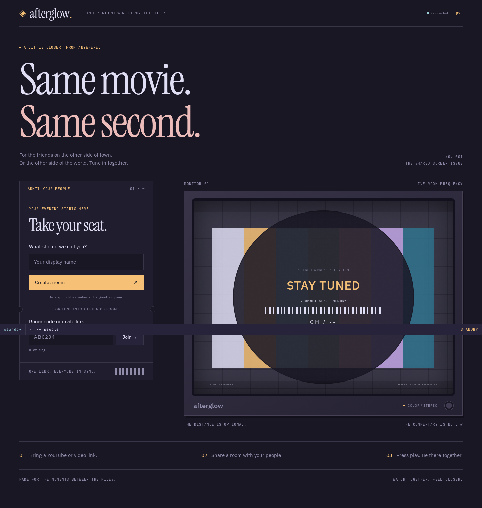
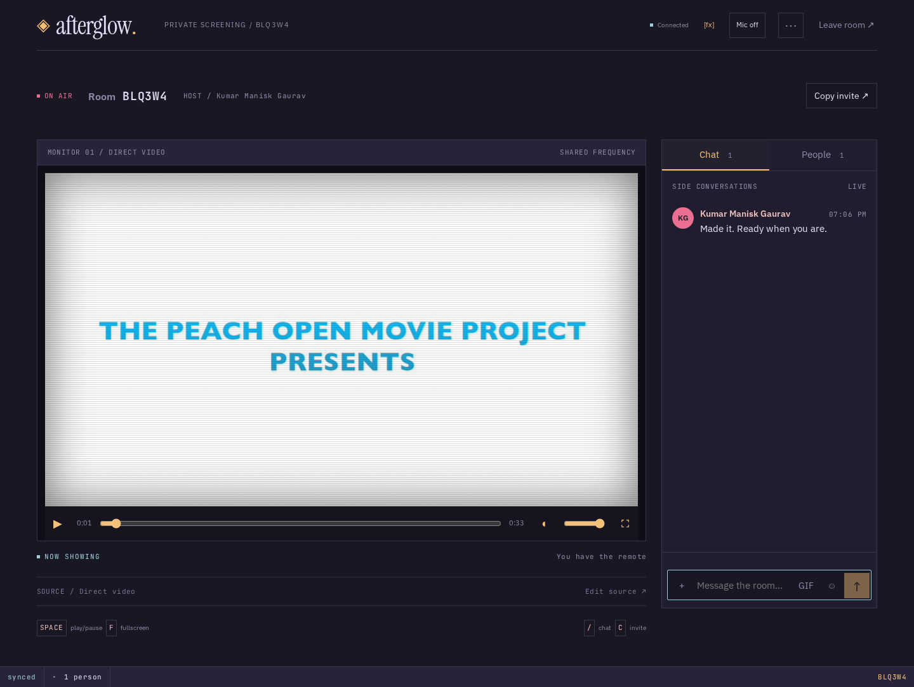

# Afterglow — same movie, same second

A private watch-party room for your people. Create a room, share a link and watch
YouTube or direct MP4/WebM videos together with live chat. No account or database.

Rosé Pine interface, local Instrument Serif / IBM Plex Sans / JetBrains Mono, a CRT test card,
a ticket join flow and a fixed statusline with real runtime measurements. The Figma
connector's tool quota prevented frame inspection; [DESIGN.md](DESIGN.md) records
that limitation and the implemented written brief.

## Local development

Requires Node **22.12+** (24 recommended) and npm. Everything lives in this project
subfolder, `/home/onyx/Projects/watchparty/`.

```sh
cd /home/onyx/Projects/watchparty
npm ci
npm run dev
```

Open **http://localhost:5173**. Vite proxies `/api`, `/socket.io` and `/healthz` to
Express on port 3001. Optional configuration is documented in `.env.example`; copy
it to `.env` only if you need overrides. After editing shared types, rebuild them
with `npm run build -w @watchparty/shared` (or restart `npm run dev`).

## Local production

```sh
npm ci
npm run build
NODE_ENV=production npm start
```

Open **http://localhost:3001**. Express serves the built client, deep links, room
lookup, health checks and sockets from one origin. `PORT` defaults to 3001 and
`HOST` to 0.0.0.0. Use the laptop's LAN address for a phone on the same network.
Use HTTPS after deployment; clipboard APIs outside localhost need a secure context.

## Screenshots

Screenshots are generated from actual browser tests, not Figma renderings.

<!-- Screenshot slot: docs/screenshots/home-1440.png -->


<!-- Screenshot slot: docs/screenshots/room-1440.png -->


<!-- Screenshot slot: docs/screenshots/room-390.png -->


## Use

- Enter a display name and create a room, or paste a six-character code/invite.
  Lookup waits 300 ms, cancels stale requests and shows waiting, tuning, found or
  no signal. The CRT displays the entered channel.
- Only the host can load media or control play/pause/seek. Guests follow and retain
  their local sound/fullscreen controls. Source errors and browser autoplay prompts
  are visible. Try the sample-film link or your own embeddable YouTube video.
- Chat and People are actual keyboard-accessible tabs. Chat includes timestamps;
  People shows the host. Copy invite reports success or the actual URL on failure.
- Shortcuts: **J/K/L** seek/play/pause (host), **Space** play/pause, **F** fullscreen, **/** focus chat,
  **C** copy invite, **X** FX, **M** microphone. Typing suppresses shortcuts.
- `[fx]` toggles screen effects. Reduced-motion preference disables effects even
  when the toggle is on. Scanlines, vignette and grain stay over the display.
- The statusline shows measured player drift, measured clock-request RTT, current
  playback revision, connection/sync state, host and participant count. Unavailable
  values show `--`; these are observations, not a latency guarantee.

## Architecture and synchronization

| Workspace         | Responsibility                                                               |
| ----------------- | ---------------------------------------------------------------------------- |
| `apps/client`     | React/Vite UI, media adapters, lookup, clock measurement and diagnostics     |
| `apps/server`     | Express/Socket.IO, rooms, host permissions, validation, rate limits and logs |
| `packages/shared` | Event contracts, validation, permissions, timeline and drift math            |

### Sync algorithm

The server owns playback position, timestamp and revision; the wire protocol is unchanged.
At connect, five pings 200ms apart select the lowest-RTT clock offset.
Three pings every 30s refresh it with a .3 EMA; samples over twice the best RTT are ignored.
Late join, reconnect and foreground resume align to the expected server position once.
Playing drift is measured at 1Hz, skipping hidden, buffering and seeking players.
Files nudge rate by 5% after two bad samples; active nudges stop below 50ms drift.
Normal file deadband is 120ms; drift above 2s seeks. YouTube seeks above 600ms, at most every 4s.
Programmatic events have a 600ms echo guard; matching state/rate events never emit controls.
Only hosts send commands, bounded to duration and throttled per action with a trailing final value.
Scrubbing sends once on release; autoplay denial waits for a gesture and then realigns.
Playback revisions reject stale/duplicate playback; same-revision chat and presence still arrive.
An external telemetry store publishes at most 4Hz; the main room does not rerender on each tick.

A disconnected host is immediately replaced by the next participant. Rejoin keeps
the new host. Socket.IO can recover identity after unexpected transport loss within
30 seconds, while the process and room survive; the client still explicitly rejoins
for an authoritative snapshot. Intentional leave, refresh and expired recovery use
a new identity. Empty rooms are deleted immediately. A server restart loses all rooms.

## API and limits

- `GET /healthz`: `200 {"status":"ok"}`; shutdown changes readiness to 503.
- `GET /api/rooms/:code`: 200 with only code/count/capacity; 400 for invalid code,
  404 for a missing room, 429 when rate limited. Responses are not cached.
- 1,000 rooms, 24 participants per room, names 1–32 printable characters, messages
  1–500 characters, last 100 messages retained, URL length 2,048 and incoming socket
  payload 8 KiB. React renders user content as text.
- Per socket: existing burst of 40 mutations, replenishing at 4/second. Additionally
  per-IP token buckets limit creates to 10/minute, joins to 60/minute, chat to
  120/minute and lookup to 120/minute. Shared networks share those limits. Buckets
  are bounded and require no background service or database.
- Helmet restricts script/frame origins to required YouTube endpoints, HTTPS media,
  local fonts and WS/WSS. Production JSON logs omit user content and invite codes.
  Shutdown drains sockets/HTTP and has a 10-second forced deadline.

## Verify

```sh
npm run lint
npm run typecheck
npm test
npm run build
npx playwright install chromium
npm run test:e2e
```

Unit/integration tests exercise shared math, permissions, validation, two-client
play/pause/seek, late join, promotion, rejoin/recovery, lookup, limits and shutdown.
Chromium tests use a tiny local WebM with byte-range support and verify real video,
chat, reconnect, responsive overflow, tabs, keyboard, clipboard, reduced motion,
lookup state mapping/stale cancellation and custom 404. Screenshots go to ignored
`test-results/`. Run `NODE_ENV=production npx playwright test` after building to
exercise the production CSP and logs too.

## Deployment preparation

**No deployment has been performed.** [DEPLOY.md](DEPLOY.md) contains exact Render
settings, the four manual local checks and post-deployment verification.

```sh
docker compose up --build -d
# http://localhost:3001
docker compose down
```

The image is multi-stage, non-root and health-checked. Docker is unavailable on the
preparation machine, so execution is deferred to CI or a Docker-equipped workstation.
`render.yaml` prepares exactly one Node service with manual deployments. The GitHub
Actions workflow installs, audits, lints, typechecks, tests, builds, runs browser tests, builds
Docker and checks the running container. The current directory has no Git repository
or remote; create/push only this project folder when ready. No cloud resources or
secrets are required until the deployment session.

## Scope and remaining release work

In-memory state requires **one instance**; do not horizontally scale this MVP.
Invite codes provide access; share only with people you trust. DRM/private streaming
services and HLS/DASH are outside scope. Providers can deny embedding; HTTPS media
still needs supported codecs and seek/range support. Media is fetched by the browser,
not proxied or downloaded by the server.

Before deployment: reconcile against Figma when its quota/access is restored, add
the TODO `public/og.png` artwork and test **two tabs**, **phone + laptop**,
**YouTube playback**, and **host disconnect/reconnect**. A browser test cannot
certify a physical phone/network. Fonts include SIL Open Font Licenses in
`apps/client/public/licenses/`. The CRT/test-card artwork is CSS drawn from the brief;
no Figma asset match is claimed.

## Test with more people

On one computer, create a room in a normal browser window. Copy its invite URL,
open it in a private window or a different browser, enter another display name,
and press Join. Repeat for a third participant. Opening the URL alone displays the
join form: each person must enter a name and click Join. People should show all
participants. Only the host has playback controls.

For a phone or another laptop on the same Wi-Fi, replace `localhost` in the invite
with the host laptop's LAN IPv4 address, keeping port 3001 and `/room/<code>`.
For example: `http://<laptop-LAN-IP>:3001/room/<code>`. `localhost` on a phone means
the phone itself. Keep the server running and use a public video both devices can
load. This local address is not reachable by friends on another network; remote
internet invitations require the later HTTPS deployment.

Play, pause, seek, join late and disconnect the host. Confirm guests follow and
another participant becomes host. Browser autoplay can require each guest to click
"Click to enable playback". The browser suite now checks three simultaneous clients.

The statusline's **offset** is the measured difference between the server timeline
and the local player. Positive means the player is behind. A reading of +140ms is
within the 200ms playing tolerance; it is not 140ms of network latency. **RTT** is
network round-trip time. YouTube timestamps are estimates from its iframe API;
forcing a seek for every tiny offset would cause repeated interruptions. The app
keeps measurements truthful and corrects larger offsets automatically.

## Voice, reactions and collaborative chat

Voice is opt-in, **audio only**, and uses browser-to-browser WebRTC mesh connections.
Socket.IO forwards validated offer/answer/ICE messages only to the intended joined
peer in the same room; Express never receives or relays audio. Up to eight people
can join voice within a 24-person watch room. Everybody starts with the mic off.
Click **Mic off** once to request browser permission and join voice. Thereafter,
**M** or the mic button mutes/unmutes; M alone never triggers the initial permission
prompt. Muted voice participants can still hear others. People shows mic/speaking
state; speaking is measured locally using a lightweight audio-level analyser.

Voice currently requires each listener to opt into voice too. If the browser blocks
remote audio, click **Enable voice audio**. Leave, disconnect or capture interruption
closes peer connections and stops microphone tracks. A recovered socket preserves
identity where supported but **never automatically recaptures the microphone**.
Voice errors are isolated from video, playback synchronization and text chat.

Runtime ICE settings (not Vite build variables):

| Variable        | Default / purpose                                                              |
| --------------- | ------------------------------------------------------------------------------ |
| `STUN_URLS`     | `stun:stun.l.google.com:19302`; comma-separated STUN URLs, blank disables STUN |
| `TURN_URLS`     | Optional comma-separated `turn:`/`turns:` relay URLs                           |
| `TURN_USERNAME` | Optional TURN account username                                                 |
| `TURN_PASSWORD` | Optional TURN account credential                                               |

Copy `.env.example` to `.env` for local overrides, or set these in your hosting
service. `/api/rtc-config` supplies ICE configuration to browsers. TURN credentials
must therefore be treated as **browser-visible**, not server-only secrets; use a
restricted dedicated account, rotate it, and use a provider's short-lived credentials
for a public release. Never commit populated `.env` files. Production voice needs
HTTPS; `http://localhost` works for local testing, while plain LAN HTTP on a phone
normally cannot request microphone access. STUN does not guarantee connectivity
through every NAT/firewall; a tested TURN relay is required for reliable internet
voice. No TURN service is provisioned by this app.

Keyboard: **J** back 10 seconds, **K/Space** play/pause, **L** forward 10 seconds,
**F** toggle player fullscreen, **Esc** exit, **X** toggle FX, **M** mute/unmute,
**/** chat, **C** invite. Typing targets suppress shortcuts; only the host can send
playback controls. Fullscreen keeps the custom controls and quick reactions.

The small reaction control offers the six watch reactions. Reactions last about
1.4–1.8 seconds over the lower-right of the player, never enter chat/history or recovery
replays, and are rate limited on both client and server. FX off/reduced motion shows
them statically for about 600ms. The sender name and timestamp remain in compact chat.
Enter sends; Shift+Enter inserts a newline; drafts survive Chat/People tab switches.
Scrolling upward pauses automatic scrolling and shows an unread-message control.

Paste a supported direct HTTPS GIF/image URL as chat, or use **GIF** beside the
composer. URLs must be at most 500 characters, have a GIF/PNG/JPEG/WebP/AVIF path,
and belong to Giphy, Tenor, i.imgur.com, upload.wikimedia.org,
images.unsplash.com, cdn.discordapp.com or media.discordapp.net. SVG, HTML,
credentials, custom ports, localhost/IP addresses and other domains are rejected.
The browser decodes images directly with constrained dimensions and no referrer;
the server never fetches or proxies URLs and never renders arbitrary HTML. A URL
shape cannot guarantee the provider's actual response: failed images show a small
unavailable state. GIFs use the same message validation, limits and last-100 history
as text. Direct-link GIFs need no key; optional GIPHY search requires its server-side key.

Mutation limits remain in force. Reactions have an additional five-per-two-second
server burst per socket plus a 400ms client cooldown. Voice signaling has its own
1,200/minute per-IP budget; presence has 2,400/minute per-IP plus eight/second per
socket, so audio-level updates do not consume playback/chat's mutation budget.
Shared networks share the IP budgets.

## Realtime polish: audio, motion and GIPHY

Reactions render optimistically inside the player with a client identifier so the
server echo cannot create a duplicate. Up to twelve overlap; oldest instances are
removed beyond that limit. Their transform/opacity-only motion lasts 1.4–1.8 seconds
with scale entry, a 90–160px rise, drift and rotation. Reduced motion or FX off uses
a small static 600ms reaction. No reaction enters chat history or recovery replay.

Speaking indicators use real local/received audio RMS sampled about 17 times per
second. Separate start/stop thresholds and a 160ms quiet release prevent flicker;
React/presence updates happen only on speaking transitions. Mute/disconnect stops
the indicator. Analysers, timers, audio nodes and tracks are torn down with voice.
People lists name, host badge and off/muted/live state; speaking outlines and the
header mic border pulse only while speaking. Fullscreen keeps a speaking-name strip.

Received audio passes through a native Web Audio compressor (threshold -24dB,
ratio 3:1, short attack, moderate release) and unity gain. Microphone capture still
uses only the browser's echo cancellation, noise suppression and automatic gain.
Voice stays peer-to-peer: the application server forwards signaling, never audio.

**Audio settings → Voice ducking: On** is the default and persists locally. Only
received speaking audio ducks the movie to 60% of the separately retained base
volume, with 100ms attack and 380ms release. Multiple speakers do not compound the
attenuation. Local speech alone does not duck. HTML5 volume and YouTube's own
getVolume/setVolume APIs are used; YouTube audio is never connected to Web Audio.
The volume control edits the base volume, which is restored exactly when speech
ends or ducking is disabled. Mute remains mute, and zero remains zero.

Set optional **`GIPHY_API_KEY`** in `.env` or the hosting environment and restart
the server to enable **GIF** search/trending. It is server-only: never prefix it
with `VITE_`, put it in client code, logs or Git. The native picker uses the same
origin's `/api/gifs/trending` and `/api/gifs/search?q=...`, 275ms debounce, cancellation,
lazy small previews, keyboard controls and the official Powered by GIPHY mark.
Search is limited to 50 printable characters. Responses contain only id/title,
preview/original URLs and dimensions; identical results are held in a bounded
30-second cache, with concurrent requests coalesced and provider failures handled.
No SDK or animation package was added. Images load directly from their provider.
Selected images use typed GIF messages and open the original safely in a new tab.
With no key, the panel says `GIF search unavailable`; **Link** and ordinary chat
still work. The keyless state and provider calls are tested with isolated mocks.

**Provider approval before release:** GIPHY's current published guidance prohibits
API proxying and caching by default and requires client-side search/trending calls.
The requested server-side secret-key/cache design is implemented for local testing,
but do not enable it in a public deployment until GIPHY approves that design or
review a compatible alternative. See [GIPHY's integration guidance](https://developers.giphy.com/docs/api/#best-practices)
and [DEPLOY.md](DEPLOY.md). No key or provider approval was supplied during this pass.


## Shared-room presence and messaging

Every participant has a deterministic name-based monogram. Measured local/remote
RMS drives avatar ring strength at about 17Hz through CSS properties, without React
updates for every sample. Up to three active speakers appear over the movie and in
fullscreen; the overlay fades for 450ms after silence and clears on disconnect.
Local microphone audio is never played locally. Browser echo cancellation, noise
suppression and AGC remain enabled. Received audio uses the existing conservative
compressor and unity gain. Movie ducking still uses 60% of the chosen base volume,
100ms attack/380ms release, exact restoration, and a persistent overflow preference.

Chat uses a compact sticky composer, plain-text paste, four-line growth, Enter to
send, Shift+Enter for newline, and a 500-character limit. Emoji-only messages of one
to three graphemes appear larger. Video reactions remain separate from history.
The plus action contains reactions and the validated direct-image Link fallback.
Normal statusline shows sync, count and channel; append `?debug=1` for telemetry.
Loaded media collapses Source into an editable row. Keyboard controls are unchanged.

### GIF search diagnosis and configuration

At this pass's local inspection there was no `.env` and `GIPHY_API_KEY` was unset;
HTTP 503 was the intended credential-missing response, not a CSP or abort failure.
Create `.env` from `.env.example`, set the key locally, and restart. Both `npm run dev`
and `NODE_ENV=production npm start` load the project-root `.env`. Never use a `VITE_`
variable for this key. Missing keys show only `GIF search unavailable`; Link remains
available. Live-provider access has not been claimed without a key.

Trending/search routes accept `limit=1..24` (default 24). Empty results, retryable
failures and quota limits have distinct UI states. Search debounces 250ms; only stale
requests are cancelled. Upstream error status/body is logged in bounded form with
API credentials redacted; normalized responses never expose the key or provider
payload. Integration tests mock success, empty results, 401, 429, malformed responses
and network failure. GIPHY's approval requirement for this requested server proxy
and cache remains described in DEPLOY.md. No provider account has been created.
