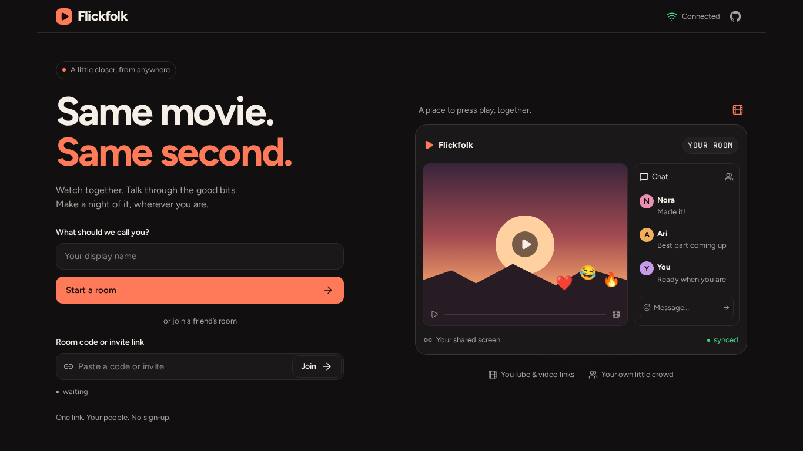
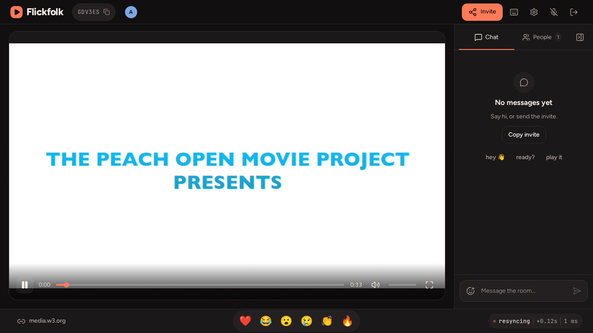
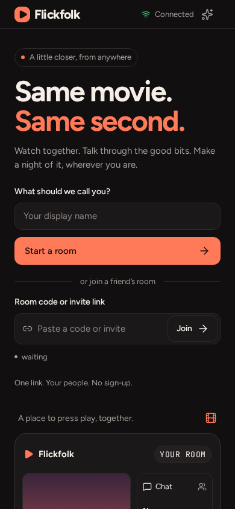
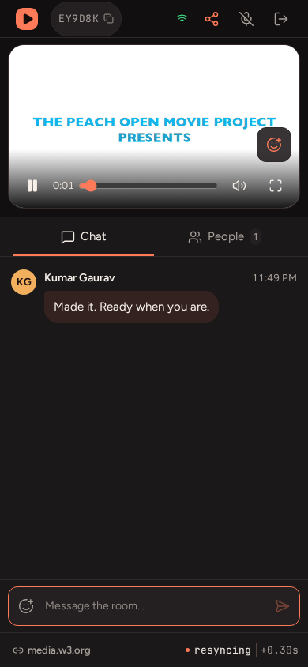

<div align="center">
  

# Flickfolk

**Same movie. Same second.**

A real-time watch-party app for watching videos together with synchronized playback, voice chat, reactions, shared rooms and local-file playback.

[Live app](https://flickfolk.onrender.com) · [Architecture](ARCHITECTURE.md) · [Deployment](DEPLOY.md) · [Design](DESIGN.md)

<br />


</div>

## What it does

Flickfolk creates shared rooms where everyone watches the same media on the same timeline.
The server owns the authoritative playback state while each browser plays the media locally.

- Create or join rooms with a short code or invite link.
- Synchronized play, pause, seek and source changes.
- Host, Moderator and Participant roles with server-enforced permissions.
- Participant control requests that Hosts or Moderators can approve or deny.
- Late-join alignment, reconnect handling and automatic host failover.
- Peer-to-peer WebRTC voice chat with speaking indicators and movie ducking.
- Reactions, text/GIF chat and responsive desktop/mobile layouts.
- Local-file watch parties without uploading the video.
- Direct video/audio URLs plus adaptive streaming and supported embeds.

## Media support

| Source | Playback |
| --- | --- |
| YouTube | Full synchronized playback through the YouTube IFrame API |
| Direct video URLs | Native browser playback, including signed/extensionless media URLs |
| HLS `.m3u8` | Native HLS where available, otherwise lazy-loaded `hls.js` |
| MPEG-DASH `.mpd` | Lazy-loaded `dash.js` over the same synchronized player |
| Local files | MP4, WebM, MKV, MOV, AVI, MPEG, transport-stream and other browser-decodable containers |
| Direct audio | MP3, OGG, M4A and other browser-supported audio |
| Twitch | VOD timeline sync; live streams use live-capability controls |
| SoundCloud | Track and playlist playback through the official widget |
| Spotify | Official embed controls with provider-specific capability limits |
| Kick | Official live-stream embed |

Container support does not guarantee codec support. For example, an MKV file can still contain a codec that a particular browser cannot decode. Flickfolk reports that cleanly instead of transcoding or uploading the file.

## Local file sync

Local videos stay on each viewer's device.

The Host or Moderator selects a file, Flickfolk fingerprints a small sample in a Web Worker, and only safe metadata is shared with the room. Every other viewer selects their own copy of the same video.

```text
local File
   ↓
Object URL in the browser
   ↓
native HTML5 video
   ↓
existing Flickfolk sync engine
```

Only the sanitized filename, size, duration and SHA-256 fingerprint reach the server. File bytes and filesystem paths never leave the device.

Exact copies match automatically. A different encode with a duration within two seconds can be accepted explicitly with **Use anyway**. Refreshing the page intentionally requires selecting the local file again.

## Screenshots

### Desktop





### Mobile

<p align="center">
  
  
</p>

## Tech stack

| Layer | Technology |
| --- | --- |
| Frontend | React 19, TypeScript, Vite |
| Backend | Node.js, Express, Socket.IO |
| Realtime media | WebRTC |
| Playback | HTML5 media, YouTube IFrame API, hls.js, dash.js |
| Styling | CSS, local Figtree and JetBrains Mono fonts |
| Testing | Vitest, Playwright |
| Deployment | Docker, GitHub Actions, Render |

## Architecture

Flickfolk uses a server-authoritative room model.

```text
Browser intent
    ↓
Socket.IO
    ↓
server validation + role permissions
    ↓
authoritative room/playback state
    ↓
room broadcast
    ↓
local playback engine corrects drift
```

The server owns room membership, roles, playback state, revisions and permissions. Browsers own actual media playback, UI state and local WebRTC audio.

The synchronization engine estimates clock offset, aligns late joiners, rejects stale revisions and corrects drift using small playback-rate nudges or seeks depending on the provider.

Project layout:

```text
apps/client      React/Vite UI, player adapters, voice and room experience
apps/server      Express, Socket.IO, room state, validation and signaling
packages/shared  shared types, permissions, media parsing and sync policy
```

See [ARCHITECTURE.md](ARCHITECTURE.md) for the deeper implementation notes.

## Roles

| Capability | Host | Moderator | Participant |
| --- | --- | --- | --- |
| Play / pause | Direct | Direct | Request |
| Seek | Direct | Direct | Request |
| Change source | Direct | Direct | Request |
| Approve requests | Yes | Yes | No |
| Promote / demote | Yes | No | No |
| Remove participant | Yes | No | No |
| Chat / reactions / voice | Yes | Yes | Yes |

Permissions are checked on the server. Client-side disabled controls are only UI feedback.

## Development

Requires Node.js 22.12+ and npm.

```bash
npm ci
cp .env.example .env
npm run dev
```

For a production build:

```bash
npm run build
NODE_ENV=production npm start
```

Docker:

```bash
docker compose up --build
```

The production container runs as a non-root user and exposes `/healthz`.

## Optional configuration

Voice uses browser WebRTC and works without an account. Public STUN is available by default; restrictive networks may require TURN.

```env
STUN_URLS=
TURN_URLS=
TURN_USERNAME=
TURN_PASSWORD=
```

GIF search is optional and uses a server-side GIPHY key:

```env
GIPHY_API_KEY=
```

Without a configured provider, the rest of chat remains fully functional.

## Keyboard controls

| Key | Action |
| --- | --- |
| Space / K | Play or pause |
| J / L | Seek −10s / +10s |
| F | Toggle stage fullscreen |
| Escape | Exit fullscreen / close transient UI |
| M | Mute microphone after joining voice |
| `/` | Focus chat |
| C | Copy invite |
| T | Toggle sidebar |

Playback shortcuts still follow the current user's room permissions.

## Verification

```bash
npm run lint
npm run typecheck
npm test
npm run build
npm run test:e2e
```

Current suite:

- 220 unit/integration tests
- 41 Playwright browser tests
- Docker build + non-root health smoke test in GitHub Actions

## Deployment

Production: **https://flickfolk.onrender.com**

The current deployment runs the React client and Socket.IO server from the same Node service. Rooms are kept in memory, so a service restart clears active rooms.

For horizontal scaling, room state would need to move to shared storage and Socket.IO broadcasts/recovery would need coordinated multi-instance infrastructure.

---

<div align="center">
  <strong>Flickfolk</strong><br />
  Same movie. Same second.
</div>
