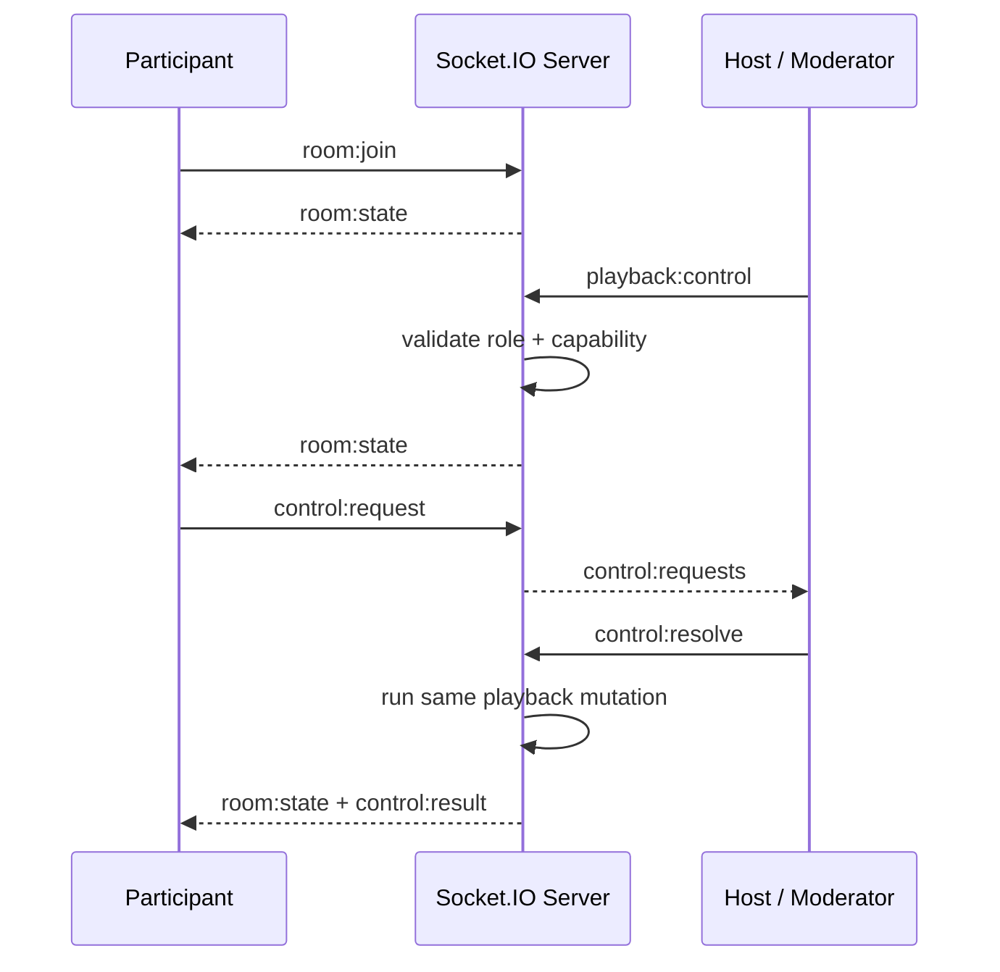

# Flickfolk

**Same movie. Same second.**

A signup-free shared watch room with synchronized media playback, peer-to-peer
voice, live reactions and collaborative chat. The Warm Dusk interface uses local
Figtree/JetBrains Mono fonts, configurable accent controls and deterministic initials avatars.
No accounts, camera, database or paid service are required for the core app.

**Live:** [flickfolk.onrender.com](https://flickfolk.onrender.com)

[Live app](https://flickfolk.onrender.com) · [Source](https://github.com/kmanisk/flickfolk) · [Deployment guide](DEPLOY.md) · [Design](DESIGN.md)

## Try it in 60 seconds

1. Open Window A and enter a display name. Start a room.
2. Copy the invite and join from Window B/incognito with another name.
3. In A, use the bottom source chip to load a YouTube URL. Press Play.
4. In B, playback controls are restricted. Open Requests and choose Request pause.
5. In A, open Requests and approve. Both players pause.
6. In A, open People, manage B and choose Make moderator.
7. In B, play/pause/seek directly; A follows the authoritative timeline.
8. In A, manage B and remove them, confirming the action.
9. B sees the removal screen; refreshing cannot automatically rejoin. Back home
   allows an intentional fresh join. No account is required.

## Roles and participant requests

| Capability | Host | Moderator | Participant |
| --- | --- | --- | --- |
| Play/pause | Direct | Direct | Request |
| Seek | Direct | Direct | Request |
| Change video | Direct | Direct | Request |
| Approve requests | Yes | Yes | No |
| Assign roles | Yes | No | No |
| Remove users | Yes | No | No |
| Chat | Yes | Yes | Yes |
| Reactions | Yes | Yes | Yes |
| Voice | Yes | Yes | Yes |

The server reads roles from its own participant state on every privileged command.
UI checks explain permissions; they provide no security boundary. Provider capability
restrictions apply to every role, including approved requests. Reviewers receive a
private queue: at most three pending requests per participant, one per action, for
60 seconds. A playback revision/source change, departure or role change invalidates
stale requests. Approvals use exactly the same mutation path as direct controls.
The host can promote/demote and kick. Removal is a kick, not a permanent ban.
Host failover prefers the first Moderator, then the first Participant. Socket
replacement preserves roles; reconnect within 30s restores a Moderator/Participant
role while the room exists. A departed Host returns as Moderator after failover,
so the new Host retains authority and there is always exactly one Host.

## Development

Requires Node 22.12+ (24 recommended) and npm. Run from this project directory:

```bash
npm ci
cp .env.example .env
npm run dev
```

The Vite development server proxies the API and Socket.IO to the Node server.
Open two browser sessions, create a room and use the invite link in the second
session with a different display name. Microphones start off.

For a production build served by Express:

```bash
npm run build
NODE_ENV=production npm start
```

`PORT` and `HOST` are configurable. Both npm launch paths load the project-root
`.env`; restart after changing server configuration.

```bash
docker compose up --build
```

Docker runs as a non-root user and checks `/healthz`. This setup has one process,
in-memory rooms and no persistence: restarting loses rooms, messages and invites.

## What works

- Create/join by six-character code or invite URL, with debounced room lookup.
- Server-authoritative Host/Moderator timeline controls for YouTube, direct video/audio, Twitch VOD and SoundCloud.
- Capability-aware Twitch live, Spotify and Kick embeds without invented timeline sync.
- Late joins, reconnect identity where Socket.IO recovery is available, host promotion.
- Audio-only WebRTC voice with actual RMS speaking rings and a fullscreen speaker overlay.
- Six ephemeral reactions; optimistic floats reconcile server echoes and cap at 30 nodes.
- Grouped text/GIF chat, large emoji-only messages, plain-text multiline composer and unread counts.
- Viewport-bound desktop rooms, mobile layouts, collapsible sidebar and stage fullscreen.
- Real sync/drift/RTT telemetry. No fake metrics, participants, movie metadata or queues.

GIF search is optional. With no configured working GIPHY integration its button is
hidden. Validated direct image/GIF links remain available under the emoji picker’s
**Link** action. Reactions are separate from messages and never enter chat history.

## Screenshots


## Architecture

| Workspace | Responsibility |
| --- | --- |
| `apps/client` | React/Vite, native UI, lazy Room/voice/GIF chunks and provider adapters |
| `apps/server` | Express, Socket.IO, authoritative room state, validation, signaling and limits |
| `packages/shared` | Typed events, brand, validation, permissions, clock/correction math |

`packages/shared/src/brand.ts` is the product brand source. Existing `afterglow-*`
local-storage keys and `@watchparty/*` internal workspace names remain compatible.
The server serves the built client in production. Hashed assets have one-year
immutable caching; HTML is revalidated. Compression and Helmet CSP are enabled.
The UI uses Lucide individual imports and self-hosted Fontsource latin fonts.

### WebSocket flow



Full authoritative snapshots keep participants, roles, media and playback together,
reducing divergence between clients. Playback has a revision; same-revision snapshots
still carry chat/presence updates. Reviewer queues are separate and never enter the
public room snapshot.

| Assignment wording | Flickfolk event |
| --- | --- |
| `join_room` | `room:join` |
| `leave_room` | `room:leave` |
| `sync_state` | `room:state` |
| `play` | `playback:control {action:"play"}` |
| `pause` | `playback:control {action:"pause"}` |
| `seek` | `playback:control {action:"seek"}` |
| `change_video` | `media:set` |
| `assign_role` | `role:assign` |
| `remove_participant` | `participant:remove` |
| `user_joined` | `room:state` |
| `user_left` | `room:state` |
| `role_assigned` | `role:assigned` + `room:state` |
| `participant_removed` | `participant:removed` + `room:state` |

### Sync algorithm

The server owns position, timestamp, playing state and revision; the wire protocol is preserved.
Five initial clock pings 200ms apart select the lowest-RTT sample.
Three every 30s refresh offset with a .3 EMA, rejecting samples above twice the best RTT.
Late join, foreground resume and reconnect align to the expected current timeline.
Visible playing clients measure drift at 1Hz, skipping buffering/seeking players.
Files nudge by 5% after two bad samples; active nudges stop below 50ms.
Normal file deadband is 120ms; drift above 2s seeks. YouTube seeks above 600ms, at most every 4s.
Programmatic actions have a 600ms echo guard; rate changes never emit commands.
Host/Moderator commands are clamped and throttled, with final scrubs emitted on release.
Autoplay denial waits for a gesture, then realigns to the current timestamp.
Only playback is versioned: stale playback is dropped without discarding chat/presence.
Telemetry is an external store publishing at most 4Hz; playback labels use DOM refs.

See [ARCHITECTURE.md](ARCHITECTURE.md) for the engine boundaries.

## Local file sync

A Host or Moderator can choose **Local file** from the source popover. Flickfolk never
uploads the video: the browser plays a local `File` through an object URL, while the
server receives only a sanitized filename, size, duration and SHA-256 fingerprint. Each
participant selects their own copy. Exact fingerprints load automatically; another encode
within two seconds of the host duration can be accepted explicitly with **Use anyway**.
A refresh loses the browser File handle by design, so that viewer selects the file again.

Browser codec support still applies. WebM is the most reliable cross-browser test format;
MP4/H.264 works where the browser provides that codec, while containers such as MKV may
not decode. Local playback keeps the file's own resolution and uses the same native HTML5
sync/correction engine as direct video URLs. File bytes and filesystem paths never cross
the network.

## Media providers

Paste a URL; the source popover detects its provider. There is no media proxy or download service.

| Source | Room controls and limits |
| --- | --- |
| Direct `.mp4`/`.webm` | Existing HTML5 full timeline sync; codec/server access must work in the browser. |
| Direct `.mp3`/`.ogg`/`.m4a` | Same HTML5 adapter and full timeline sync where the browser supports the codec. |
| YouTube | Existing IFrame API implementation and full timeline sync. |
| Twitch VOD | Official Player API, play/pause/seek and measured timeline alignment. |
| Twitch live | Play/pause only, LIVE state, no seeking/duration/drift claims. |
| SoundCloud track/playlist | Official Widget with attribution; playlists use measured per-track durations as a combined timeline. Incomplete/restricted timelines may be unavailable. |
| Spotify | Official iframe API only. Music/collections have play/pause, no invented seek/volume/timeline. Podcast episodes expose seek/position/duration. Always marked limited. |
| Kick | Official livestream iframe; native local controls only, LIVE/embed state, no synchronized playback or volume claim. |

Capabilities are shared with the server, which rejects disabled operations before any room mutation.
New iframe sources use conservative seek correction rather than unsupported rate nudges.
No account is needed for Flickfolk. Providers may impose their own login, rights, ads,
regional or autoplay restrictions. Blocked controllable playback offers a gesture gate;
provider failure leaves Flickfolk chat/voice intact. Twitch derives `parent` from the
current hostname and officially requires a 400×300 player; use fullscreen on small screens.
Cross-origin iframe focus belongs to that provider; Flickfolk shortcuts operate in
Flickfolk's document, including its focused player controls.
Mobile audio embeds reserve enough height for native controls and attribution; chat
keeps its own scroll area and pinned composer. Only selected provider APIs load.
Home loads no provider SDKs.
Spotify runs in a small same-origin bridge frame because its current SDK requires
dynamic evaluation. Only that frame route permits eval; Flickfolk's main CSP does not.
A validated MessageChannel carries controller actions/state; no user HTML is inserted.

References: [Twitch Player](https://dev.twitch.tv/docs/embed/video-and-clips/),
[SoundCloud Widget](https://developers.soundcloud.com/docs/api/html5-widget),
[Spotify iframe](https://developer.spotify.com/documentation/embeds/references/iframe-api),
[Kick iframe](https://help.kick.com/en/articles/8010826-how-to-embed-your-kick-livestream).

## Voice and privacy

Voice implementation loads after the first mic click. Browser microphone permission
is explicit; permission/network failure produces a dismissible toast and leaves
video/chat working. `echoCancellation`, `noiseSuppression` and `autoGainControl`
remain browser-managed. No camera is requested; local microphone audio is not played
back to its sender. Use the intended system recording device in browser settings.

Socket.IO carries offer/answer/ICE signaling and mic presence only. Audio travels
peer-to-peer in a mesh capped at eight voice participants; normal rooms allow 24.
Remote audio uses a conservative native compressor and unity gain. RMS meters sample
about 17Hz with hysteresis; CSS ring strength updates without React per-sample renders.

Remote speech ducks movie volume to 60% of the user's base volume, with 100ms attack
and 380ms release. It restores exactly, preserves mute/zero and can be disabled in
Settings. YouTube volume uses its iframe API, never a cross-origin Web Audio graph.

Set optional `STUN_URLS`, `TURN_URLS`, `TURN_USERNAME`, `TURN_PASSWORD` in `.env`.
Public Google STUN is the default; TURN is not provisioned. Restrictive networks
need a relay. Browser-delivered TURN credentials are not secrets from that browser:
use restricted, rotatable or provider-issued short-lived credentials in production.
Physical-device, echo-quality and cross-network TURN tests remain necessary.

## Optional GIF provider

Set **server-only** `GIPHY_API_KEY`, never a `VITE_` variable, and restart.
`/api/gifs/status` exposes only availability. The button appears after a successful
normalized trending check; no-key mode stays quiet and chat remains fully usable.
Search is debounced/cancellable, lazy previews retain provider URLs, and the picker
shows official attribution. `/api/gifs/trending` and `/api/gifs/search?q=...&limit=...`
return six normalized fields, with bounded results, validation, rate limits and a
short cache. Provider failures are logged with bounded credential-redacted bodies.

GIPHY's current [integration guidance](https://developers.giphy.com/docs/) restricts
API proxying/caching. The requested server-only integration needs provider approval
before public use. Tests mock provider success/failure; a live key has not been supplied.
No arbitrary user URL is fetched/proxied by this server. Inline image chat allows
validated HTTPS hosts/file shapes only and renders no user HTML.

## Controls

| Key | Action |
| --- | --- |
| Space / K | Host/Moderator play/pause |
| J / L | Host/Moderator seek −10s / +10s |
| F / Escape | Stage fullscreen / exit |
| X | Effects |
| M | Mic mute after initial permission click |
| / | Focus chat |
| C | Copy invite |
| T | Toggle sidebar |

Shortcuts run at window capture and ignore only text entry (not ranges/buttons/tabs/links). Enter sends; Shift+Enter
inserts a newline. Composer content is limited to 500 characters. Playback shortcuts
use the same role/echo-guard path as the player controls. Settings contains ducking
and effects after the current source has actually played; detailed engine version/corrections are opt-in with `?debug=1`.

## Verification

```bash
npm run lint
npm run typecheck
npm test
npm run build
npm run test:e2e
```

Vitest covers permissions, validation, clock/correction policy, echo guards, throttling,
voice signaling/presence, reactions and normalized GIF API responses. Playwright uses
real Socket.IO clients and media playback; synthetic audio passes through actual
WebRTC to verify RMS, normalization-path setup, ducking, mute/zero and cleanup.
Provider browser tests mock official SDK boundaries while using the real room/socket/engine path.
Synthetic tests do not certify live provider availability, accounts, physical microphones or relay infrastructure.
GitHub Actions runs lint, typecheck, tests, build, Playwright and Docker verification on pushes and pull requests.
The current local suite has 214 unit/integration tests and 39 browser tests.
CI is the release gate, including the non-root Docker health smoke test.

## Deployment and scaling

**Production:** [https://flickfolk.onrender.com](https://flickfolk.onrender.com)

Flickfolk is deployed as one free Render Node web service in Singapore. Express serves
the built client and Socket.IO from the same HTTPS origin. `/healthz` is available for
health checks. Deployments track the `main` branch.

The current service intentionally runs a single instance because authoritative room
state, messages and invites are in memory. A restart or redeploy clears active rooms.
A database is intentionally omitted because the assignment makes it optional for the MVP.
The free Render service may cold-start after idle; the filesystem is not persistence.
Redis is not implemented.

For multiple instances, a Socket.IO Redis adapter can distribute broadcasts, but
it does **not** make this in-memory authoritative room state shared or persistent.
A scaling design also needs consistent room ownership/state, coordinated limits,
recovery semantics and sticky routing for polling. Do not enable multiple instances
with this MVP or infer production scale from small-room tests.
